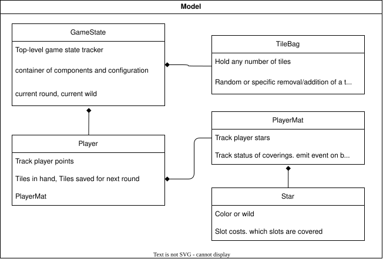

# Cloudless Sky

## Dev Setup

TODO: getting graphics forwarded in a container is hard..

If using the container on Wayland, you need to enable local user access via xhost:

```
xhost +SI:localuser:$(id -un)
```

Then the user you run with needs to have a matching UID/GID

## TODO

- Win32/64 binaries via python makelove package + Wine

## docs

### cloudless_sky/model

Model classes exist to hold game state and provide convenience functions around running the game itself


