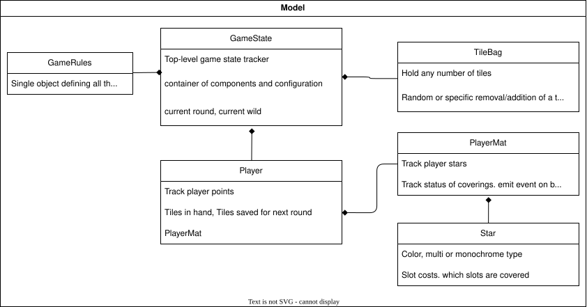
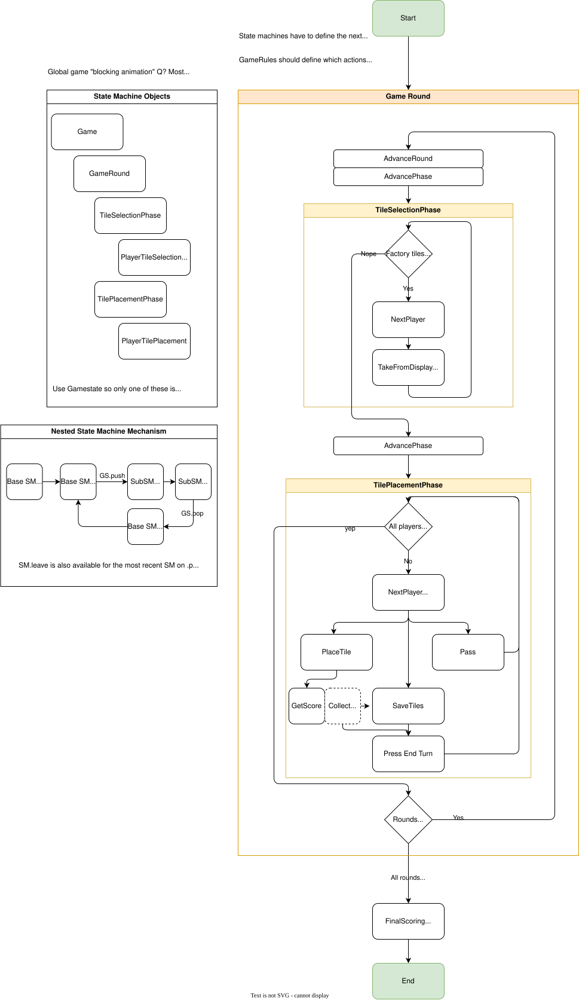

# Cloudless Sky

## Dev Setup

If using the container on Wayland, you need to enable local user access via xhost:

```
xhost +SI:localuser:$(id -un)
```

Then the user you run with needs to have a matching UID/GID

On Windows, ensure love is in the path:


```
$env:Path += ';C:\Program Files\LOVE\'
```

## Testing

Unit tests use [cute](cloudless_sky/extern/cute.lua):

```
love . --cute-headless   # run all tests, print results, exit (non-zero exit code on failure)
love . --cute            # run all tests, then launch the game with a results overlay ([h] to hide)
```

## Save / load

Save location:

- On Windows: `%APPDATA%/LOVE/cloudless_sky`

Start from a save game at startup with: `love . path/to/savegame.json`

A plain `love .` opens on the main menu.

Test saves in [test/saves](test/saves):

- `refill_on_next_fill.json`: For playing the tower -> bag refill animation
- `final_round_last_pass.json`: For testing final scoring. Player should get a star and tile bonus
- `placement_phase.json`: Starts at the first tile placement turn (both players have tiles in hand)

## iPad build

A manually run GitHub workflow builds the game and uploads it to TestFlight.

## TODO

- Win32/64 binaries via python makelove package + Wine
- MONO-STARS can turn into multi stars. you cant assume its a color-specific star after the first tile! need a second tile to know

## design rules

- model classes should avoid accesing `GameRules.currentRules()` directly
all that information should be passed to them by their controller class
- model classes should present themselves as read-only. any functions that modify their state should be
    reserved for Actions

## dependencies

- Camera: [hump.camera](https://github.com/HDictus/hump)
- Json for serial/deserialization of game state [json](https://github.com/rxi/json.lua)
- Text animation [slog](https://github.com/sysl-dev/SYSL-Text)
- Tweening [flux](https://github.com/rxi/flux)

## shaders

- cloudy background shader? 
    - https://www.shadertoy.com/view/3dVXDc
- base warp background
    - https://www.shadertoy.com/view/tdG3Rd

## docs

### cloudless_sky/model

Model classes exist to hold game state and provide convenience functions around running the game itself




### clouldless_sky/states

The game logic boils down to a series of state machines for each round, phase and turn

- **Round**: In a standard game there are 6 of these. Each round has its own wild tile, start player and two *phases*
- **Phase**: A segment of a round. Each round has 2. The Tile selection phase (picking from the factory), and tile placement (hand -> mat)
    Within a Phase, players take *turns* in the determined order to perform the actions specific to the current phase
- **Turn**: A turn is a single event performed by a Player during a given phase. These player events can cause multiple actions to occur
- **Action**: An action encapsulates some verb that occurs to the game state. Actions are handled one at a time, in the order they occur. One action can spawn more actions. For example the `PlaceTile` action can cause new `AddScore` and `CollectBonusTiles` Actions to be queued. Actions can also emit *Animations* which smooth transitions or add flavor to the visual state. Typically all animations emitted by an action must complete before the next action can be processed

Each state machine in the game waits for user input, handles resulting actions and animations, and may push other state machines onto the game state stack


