# Azul: Summer Pavilion: Rulebook (Markdown Transcription)

> **Source:** `docs/reference/azul-summer-pavilion-rulebook.pdf` (a 6-page scan of the
> official English rulebook, © 2019 Plan B Games / Next Move; designer Michael Kiesling).
> This file is a complete transcription of the rules. You should not need the PDF.
> Figures were cropped from the scan into [`images/azul-summer-pavilion/`](images/azul-summer-pavilion/).
>
> Sections marked **📝 Clarification** are not in the rulebook. They are notes added
> during transcription to remove ambiguity or record facts read off the illustrations.
> Everything else follows the rulebook's own wording and meaning.

---

## Quick Reference

| Item | Value |
|---|---|
| Players | 2–4 |
| Rounds | 6 (fixed) |
| Tiles | 132 diamond tiles in 6 colors (22 per color), drawn from a bag |
| Factory displays | 5 (2p) / 7 (3p) / 9 (4p), each filled with 4 tiles |
| Supply spaces (scoring board) | 10 tiles |
| Starting score | Space 5 on the scoring track |
| Wild color by round | 1 purple · 2 green · 3 orange · 4 yellow · 5 blue · 6 red |
| Phases per round | 1: Acquire tiles → 2: Play tiles & score → 3: Prepare next round (skipped after round 6) |
| Max tiles carried between rounds | 4 (stored on the player board's corner spaces) |

**Tile colors (6):** purple, green, orange, yellow, blue, red.

**Player board (front side):** 7 stars, each made of 6 diamond-shaped spaces:
- 6 single-color stars (red, orange, purple, green, yellow, blue), one per tile color.
- 1 **multicolored** center star (dark blue on the board), where any color may be placed but all 6 tiles must be different colors.

Each space shows a number (1–6). That number is the **total tile cost** to place one tile there.

---

## Glossary

| Term | Meaning |
|---|---|
| **Factory display** | Small round disc in the middle of the table, holding 4 tiles at the start of each round. |
| **Center of the table** | Shared pool. Leftover tiles from a Factory display are moved here after a player picks from it. |
| **Start player token** | Taken by the first player to pick from the center each round. That player goes first in Phase 2 and starts the next round. |
| **Wild color** | The one color that acts as a wild in the current round, shown by the round track. It changes every round. |
| **Tower** | Discard receptacle. Spent and discarded tiles go here; it is recycled into the bag when the bag runs out. |
| **Supply spaces** | 10 tile spaces in the center of the scoring board. Bonus tiles are taken from here. |
| **Scoring track** | Track around the scoring board's edge, running 1–80 and continuous (wraps). |
| **Point token** | "80" token taken when your marker passes 80, so you can record your total. |
| **Pillar / statue / window** | Board features (not placeable spaces) between star spaces. Surrounding them earns bonus tiles. |
| **Corner spaces** | 4 spaces in the corners of the player board, used to store up to 4 tiles between rounds. |

---

## Components & Setup

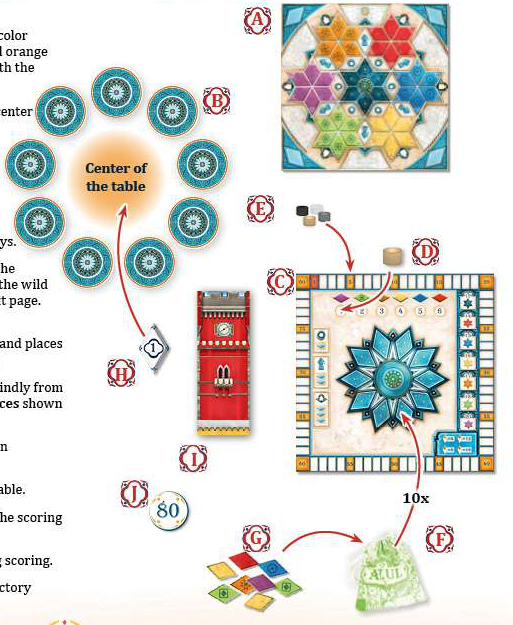

| Label | Component |
|---|---|
| A | Player boards (one per player color; the color is shown by the colored circle between the red and orange stars) |
| B | Factory displays |
| C | Scoring board (scoring track, round track, supply spaces, bonus reference) |
| D | Round counter |
| E | Scoring markers (one per player color) |
| F | Bag |
| G | 132 tiles |
| H | Start player token |
| I | Tower |
| J | Point tokens ("80") |

### Setup steps

1. Each player chooses a **player board (A)** in one player color and places it in front of them with the **colored-stars side face up**.
2. Place the **Factory displays (B)** in a circle around the center of the table:
   - 2 players: **5** Factory displays
   - 3 players: **7** Factory displays
   - 4 players: **9** Factory displays
3. Place the **scoring board (C)** next to the Factory displays.
4. Put the **round counter (D)** on the space for round 1. The counter shows the current round and also the round's **wild color**. In round 1, **purple** is wild.
5. Each player places their **scoring marker (E)** on the **5th space** of the scoring track.
6. Fill the **bag (F)** with all **132 tiles (G)**. Draw **10** tiles blindly and lay them out at random on the **supply spaces** in the center of the scoring board.
7. Fill each Factory display with exactly **4** tiles drawn randomly from the bag. Put the bag aside.
8. Place the **start player token (H)** in the **center of the table**.
9. Place the **tower (I)** between the Factory displays and the scoring board.
10. Put the **point tokens (J)** aside for use during scoring.

Return unused player boards, scoring markers and Factory displays to the box.

### Player board

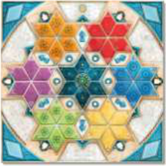

Layout (front side): orange star top-left, red top-right, purple left, **multicolored center star** in the middle, blue right, green bottom-left, yellow bottom-right.

> 📝 **Clarification (read off the board illustrations, not stated in the text):**
> - There are **6 pillars**, one in each gap between the center star and two neighbouring outer stars. Each touches **4** spaces.
> - There are **6 statues**, one between each pair of neighbouring outer stars. Each touches **4** spaces.
> - There are **6 windows** on the outer edge of the board. Each touches **2** spaces.
> - That gives 7 stars × 6 spaces = **42 placeable spaces** in total.
> - The scan is too low-resolution to read the number on every space. On the illustrated green star
>   (figure below), the spaces read **1, 2, 3, 4, 5, 6 clockwise starting from the upper-left point**.
>   The end-game "cover all 1s/2s/3s/4s" bonuses imply that **every star has exactly one space of each value 1–6**.

### Scoring board

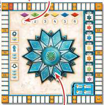

---

## Object of the Game

Be the player with the **most points** at the end of the game. The game ends after **6 rounds** and a final scoring.

## Round Structure

Each round consists of:

1. **Phase 1: Acquire tiles**
2. **Phase 2: Play tiles and score points**
3. **Phase 3: Prepare the next round** (not played in the last round)

The **youngest player** begins the first round. Play proceeds **clockwise**. Players take several turns per round.

### The wild color

In each round, one of the 6 tile colors is **wild**. The round track shows which color is wild in which round:

| Round | 1 | 2 | 3 | 4 | 5 | 6 |
|---|---|---|---|---|---|---|
| Wild color | purple | green | orange | yellow | blue | red |

Tiles of the wild color can replace tiles of any other color during that round (see [Wild color use](#wild-color-use)).

**Note:** Wild-color tiles are wild **only in the current round**. In later rounds a different color is wild, and those tiles are ordinary tiles again.

---

## Phase 1: Acquire Tiles

On your turn you **must** pick tiles, using one of two options:

### Option A: From a Factory display

- Pick **all tiles of one color** from **one** Factory display. The color must **not** be the current wild color. Place them next to your player board.
- If the display holds one or more wild-color tiles, you **must** also take **exactly one** wild tile.
- If the display holds **only** wild-color tiles, you may take only **one** wild tile.
- Move **all remaining tiles** on that display to the **center of the table**.

### Option B: From the center of the table

- Pick **all tiles of one color** from the center. The color must **not** be the current wild color. Place them next to your player board.
- If the center holds one or more wild-color tiles, you **must** also take **exactly one** wild tile.
- If the center holds **only** wild-color tiles, you may take only **one** wild tile.
- **First to pick from the center this round:**
  - Take the **start player token** and place it next to your player board.
  - Move your scoring marker **backwards** by the number of tiles you picked **this turn**, but never past **space 1**.
  - If your marker is already on space 1, you may still pick from the center without moving backwards.

### The start player token

The holder of the start player token is the **first to place tiles in Phase 2** and **starts the following round**, which gives them first pick of the Factory displays.

After placing your picked tiles next to your board, play passes clockwise.

**Phase 1 ends** when all Factory displays **and** the center of the table are empty. Continue with Phase 2.

### Turn example (round 1, purple is wild)

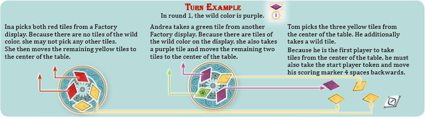

- **Ina** picks both red tiles from a Factory display. The display has no wild (purple) tiles, so she may not take any others. She moves the remaining yellow tiles to the center.
- **Andrea** takes a green tile from another Factory display. That display holds wild tiles, so she also takes **one** purple tile and moves the remaining two tiles to the center.
- **Tom** picks the three yellow tiles from the center and also takes one wild tile. He is the first player this round to take from the center, so he takes the start player token and moves his scoring marker **4** spaces backwards (3 yellow + 1 wild).

---

## Phase 2: Playing and Scoring Tiles

The **start player** (holder of the start player token) begins. On your turn:

1. Check that you have the **right number** of tiles in the **needed color** next to your board to play on a space.
2. If you do, place **exactly one** of those tiles on the corresponding space of your player board.
3. Discard the **other tiles used to pay** for that space into the **tower**.
4. Play passes clockwise.

This repeats until no player wants to, or can, place more tiles (see [Passing](#passing)).

### Rules for placement of tiles

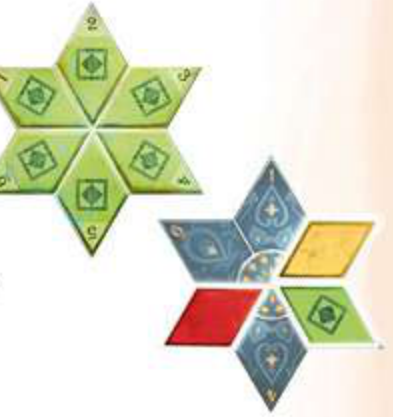

- You may only place tiles from those **next to your own** player board.
- Tiles may only be placed on the **diamond-shaped spaces**. Never place them on pillars, statues or windows.
- You may only place tiles on **empty** spaces.
- The **color of a star** shows which color may be placed there. The **number on a space** is the **total number of tiles** you must spend to place **one single tile** on that space. All the other tiles spent go to the tower.
- On the **center (multicolored) star** any color may go on any space, but all **6 tiles placed there must be different colors**.
- Tiles you do not place stay next to your player board.

### Wild color use

If you do not have enough tiles, or do not want to spend all your tiles of the needed color, you may use tiles of the **current wild color** instead. You must still have **at least one tile of the color you want to place**. All the other tiles spent are discarded into the tower.

**Hint on wild tiles:**
- Wild tiles can stand in for any other chosen color, but they must be combined with **a tile matching the color of the target space**. That tile is the one placed.
- A wild-color tile may **never** be placed on a space whose color it is standing in for. A wild-color tile may only be **placed** on a space of **its own color** (for example, a purple tile on a purple space).

**Example (purple is wild):**

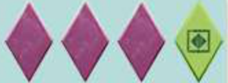

- Tom **combines** one or more purple wild tiles with his green tile and places the green tile on space "4" of the green star.
- If he **does not combine** his wild tiles with another color, he may use them on the star matching the wild tiles' own color, here the purple star.
- In both cases he could instead have placed the tile on the **center star**, if that color is not already there.

> 📝 **Clarification:** Cost for a space with value *N* and color *C*:
> - **Colored star of color C** (C is not wild): spend *N* tiles, made of ≥1 tile of color C plus any mix of C and wild tiles. Place one C tile.
> - **Star of the wild color itself:** spend *N* tiles, all of the wild color. Place one wild-color tile.
> - **Center star:** choose a color C not yet on the center star. Spend *N* tiles of C plus wild tiles, with ≥1 of C, and place a C tile. If C is the wild color, all *N* tiles are of that color.

### Scoring

- **1 point** for each tile you place. Move your marker forward 1 space.
- **Plus 1 point for each tile connected to it.** If you place a tile next to one or more already-placed, connected tiles, you also score 1 point for each of those tiles. Only spaces **next to one another on the same star** count as connected.
- The scoring track is **continuous**. When you pass 80, take a point token and lay it in front of you to record your total.

> 📝 **Clarification:** Each star is a ring of 6 spaces. Points for a placement =
> 1 + the number of tiles in the **contiguous run** of filled spaces on that star that includes the new tile
> (not counting the new tile twice). Tiles on other stars never connect, even if they look adjacent.
> See examples B and C below.

### Bonus tiles (pillars, statues, windows)

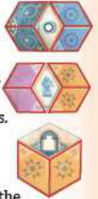

You receive bonus tiles from the **supply spaces** on the scoring board when your placement completes the surrounding of a feature:

| Feature | Spaces to fill around it | Bonus |
|---|---|---|
| Pillar | 4 adjacent spaces | Take any **1** tile of your choice |
| Statue | 4 adjacent spaces | Take any **2** tiles of your choice (both may be wild) |
| Window | 2 adjacent spaces | Take any **3** tiles of your choice (all may be wild) |

- Bonus tiles are taken **immediately** and placed next to your player board.
- Before the next player's turn, refill the empty supply spaces from the bag. If the bag is empty, refill it with all tiles from the tower and continue filling.

### Passing

If you do not want to, or cannot, place a tile on your turn, you **must pass**:

- You may keep **up to 4 tiles** from those next to your player board for the next round. Place them on the **four corner spaces** of your board. They do **not** score points.
- Discard **all other** remaining tiles into the tower and **lose 1 point per discarded tile**.
- After passing, you take no more turns this round.

> 📝 **Clarification:** Phase 2 ends when every player has passed.

### Scoring examples (round 1, purple is wild)

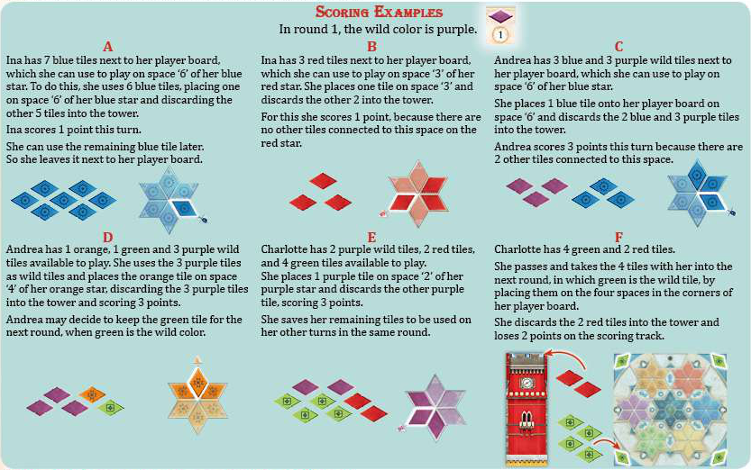

- **A:** Ina has 7 blue tiles. She plays on space "6" of her blue star: she places 1 blue and discards the other 5 into the tower. She scores **1 point** (no connected tiles). She keeps the remaining blue tile next to her board for later.
- **B:** Ina has 3 red tiles. She places 1 on space "3" of her red star and discards 2. She scores **1 point**, because no other tiles are connected to that space.
- **C:** Andrea has 3 blue and 3 purple (wild) tiles. She plays on space "6" of her blue star: she places 1 blue and discards 2 blue + 3 purple. She scores **3 points**, because 2 other tiles are connected to that space.
- **D:** Andrea has 1 orange, 1 green and 3 purple (wild). She uses the 3 purple as wilds, places the orange on space "4" of her orange star, discards the 3 purple, and scores **3 points**. She may keep the green tile for the next round, when green is wild.
- **E:** Charlotte has 2 purple (wild), 2 red and 4 green tiles. She places 1 purple on space "2" of her **purple** star, discards the other purple, and scores **3 points**. She saves the remaining tiles for later turns this round.
- **F:** Charlotte has 4 green and 2 red tiles and **passes**. She keeps the 4 green tiles on her board's corner spaces for the next round, when green is wild. She discards the 2 red tiles into the tower and **loses 2 points**.

---

## Phase 3: Preparation for the Next Round

Performed by the **start player**:

1. If round 6 has not been played yet, advance the round counter to the next round. The start player will start that round. If round 6 just ended, go to [End of the Game](#end-of-the-game).
2. Fill every Factory display with exactly **4** new tiles drawn randomly from the bag.
   - If the bag empties, refill it with all tiles from the tower and continue.
   - In the rare case that the bag **and** tower are both empty, start the round anyway, even if not all displays could be filled.
3. Return the **start player token** to the center of the table.
4. All players move the tiles from their board's **corner spaces** to **next to** their player board, ready to use in the new round.

---

## End of the Game

The game ends after **6 rounds**. Players then check the following goals and adjust their scoring markers.

### Completed star bonuses

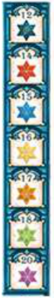

| Completed star (all 6 spaces filled) | Points |
|---|---|
| Multicolored (center) | 12 |
| Red | 14 |
| Blue | 15 |
| Yellow | 16 |
| Orange | 17 |
| Green | 18 |
| Purple | 20 |

### Number bonuses

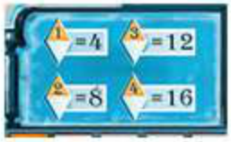

| Covered every space of value… (across all 7 stars) | Points |
|---|---|
| 1 | 4 |
| 2 | 8 |
| 3 | 12 |
| 4 | 16 |

(There is no bonus for 5s or 6s.)

### Leftover tiles and winner

- After the final round, any tiles left unused on your board's **corner spaces** are discarded into the tower, and you **lose 1 point per tile**.
- The player with the **most points** wins. Ties share the victory.

---

## Variant Play (Monochrome Board Side)

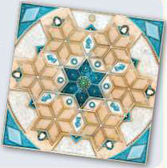

All players flip their board to the side with **monochrome stars**. The normal rules apply, with these exceptions:

- **You choose** which colors go in each of the **7** star shapes during the game:
  - For a **multicolored** star, all 6 tiles must be **different colors**, as in the normal game.
  - For a **single-colored** star, all its tiles must be the **same color**.
- You may make **more than one star of a color**, or **more than one multicolored star**. These stars score as in the normal rules.
- The **numbers on the stars differ** on this side of the board.

> 📝 **Clarification:** The rulebook does not list the variant side's space values, and the scan is
> too low-resolution to read them.

---

## Credits

Designer: Michael Kiesling · Producer & Art Direction: Sophie Gravel · Development: Peter Eggert,
Katja Volk, André Bierth, Moritz Thiele · Illustration: Chris Quilliams · Graphic Design:
Maryse Hébert-Lemire · Editing: Katja Volk. © 2019 Plan B Games Inc. / Next Move Games.
